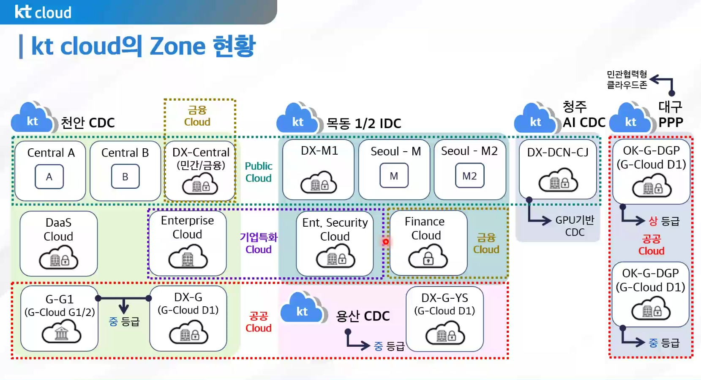
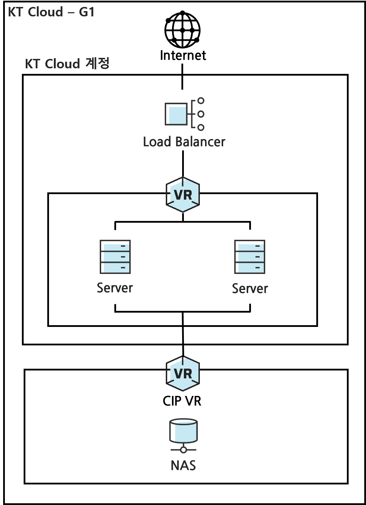
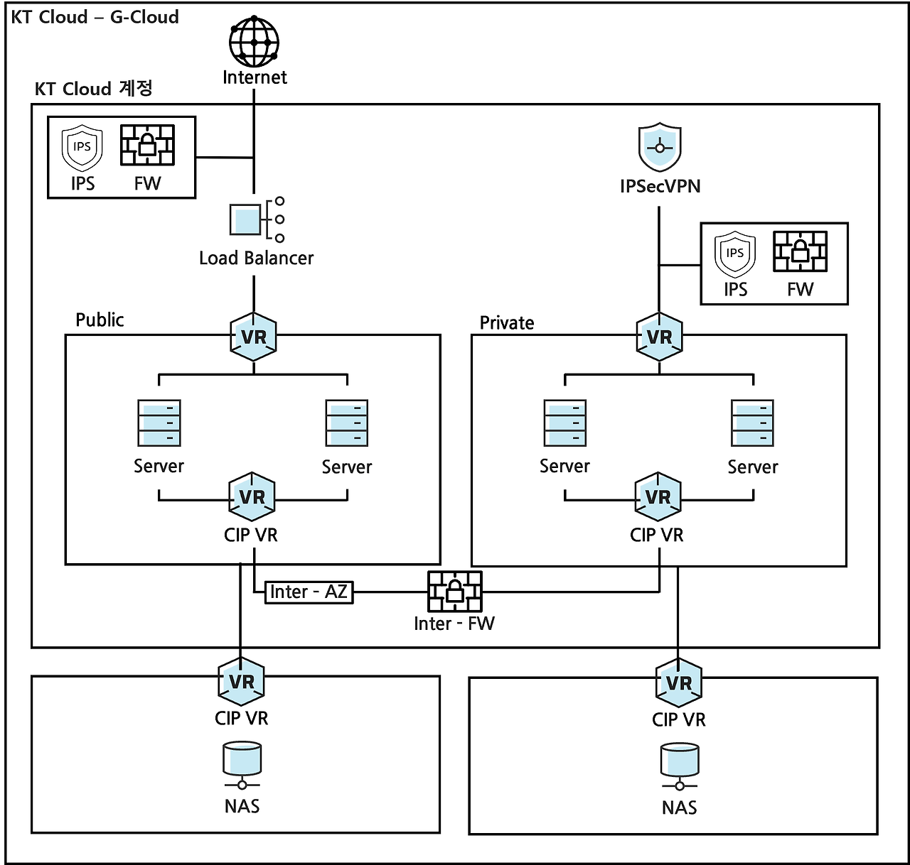
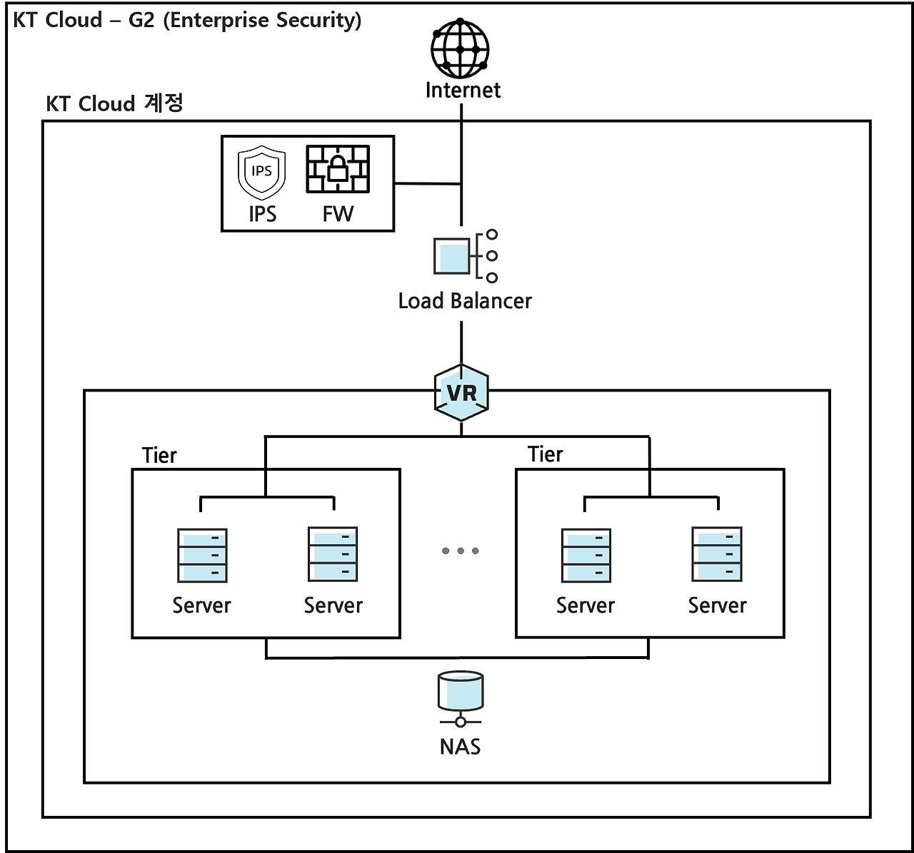
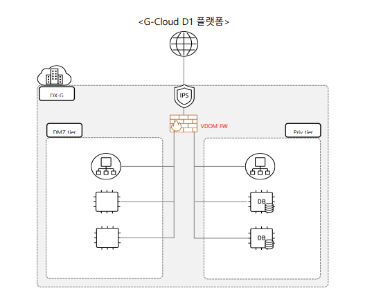

- KT Cloud는 Zone 별로 구조가 상이하니 Zone 간 차이에 대해 이해가 필요하다.

> 업무로 다룰 때(작성 시점) 기준이다. 존 구성과 상품은 바뀌었을 수 있으니 최신 내용은 KT Cloud 매뉴얼을 확인한다.

### G1/G2(A, B, M1)(Cloudstack)

- G1 존의 경우 VR 밑에서 서버가 생성된다. 이에 Subnet(tier)을 나눠서 구성이 불가하다.

- VR에서 방화벽 역할을 하지만 허용 규칙(화이트리스트)만 걸 수 있어, 특정 IP를 막는 차단 규칙(블랙리스트)은 만들 수 없다.

- NAS 연결시 NAS용 네트워크에 NAS가 생성되어 CIP를 통해 통신이 된다. 이에 CIP 대역을 서버에 붙여줘야된다.

- 기본 디스크가 HDD이다. SSD는 SSD 서버 상품 구성을 해야한다.

- KT Load Balancer는 VR 상단에 위치하게 된다. (Server를 LB로 구성한 것이다.) LB도 NAS처럼 존이 따로 존재한다.

### VR

- 방화벽 : 공격이 서버에 도달하지 않게 막아주는 역할을 한다. 다만 화이트 리스트 적용으로서의 역할만 한다.

- Port forwarding : G1존은 VR에 할당 된 기본 공인 IP를 통해 모든 서버들이 통신한다. 이에 VR에서 서버를 구분하여 서비스 할 수 있게 포트 포워딩을 해준다.

- 서버 생성/ 삭제 : 서버 생성/삭제에 관여한다. 이에 서버 비밀번호, IP도 부여한다.

- VR에서 다양한 역할을 하지만 서버이기에 서버에서 발생하는 문제(DISK full, CPU 등) 되면 모든 자원에 문제가 생기게 된다는 단점이 있다

- 또한 VR의 경우 대역폭이 정해져 있어 과도한 서비스 사용시 VR에 부하가 발생하여 서비스에 문제가 될 수 있다.

    - 이에 고급형 VR을 판다. 한 개의 서버에 KT 만의 프로그램인 router 기능을 넣어 사용자에게 제공한다. Master-Slave 구성으로 생성된다.

### G1(G-cloud, Ent-cloud)(Cloudstack)

- DMZ/Private zone으로 물리적으로 분리되어 있음

    - Subnet(tier) 생성 불가능

- DMZ zone와 Private zone간에는 DMZ F/W 과 Private F/W 에 의해 차단되며 방화벽 설정을 통해 연동

- DMZ zone에는 Web, Private zone에는 WAS 및 DB 등 배치

- 웹서비스를 이용하는 최종 사용자는 DMZ F/W - IPS - DMZ LB (옵션) - VR - VM 의 경로로 접근

### **G2(M2, Enterprise Security)**(Cloudstack)

https://manual.cloud.kt.com/kt/enterprise-security-intro

- DMZ/Private zone을 최대 13개 티어로 구성 가능

### **Dx(Dx-M1, Dx-central,** Dx-G**)**(OpenStack)

- scale up, scale out 지원

- 별도 월 비용이 붙는 상품 구성

- DMZ/Private zone으로 분리

- VR 대신 VDOM을 사용하여 여러 Tier을 관리

    - multi-tenant로 논리적 방화벽 분리 적용

    - 내부적으로 서로 다른 Tier라도 CIP로 통신하는 것이 아닌 vdom으로 통신 가능

    - 화이트 리스트, 블랙 리스트를 선택 가능

    - Tier 분리를 했기에 NAS를 다른 Tier와 공유 가능

- 각 티어와 외부 연동에는 각각의 Firewall이 존재 ( DMZ F/W, Private F/W, 외부 F/W )

    - 최종 사용자는 DMZ F/W > IPS > (DMZ LB) > VDOM > VM으로 접근
