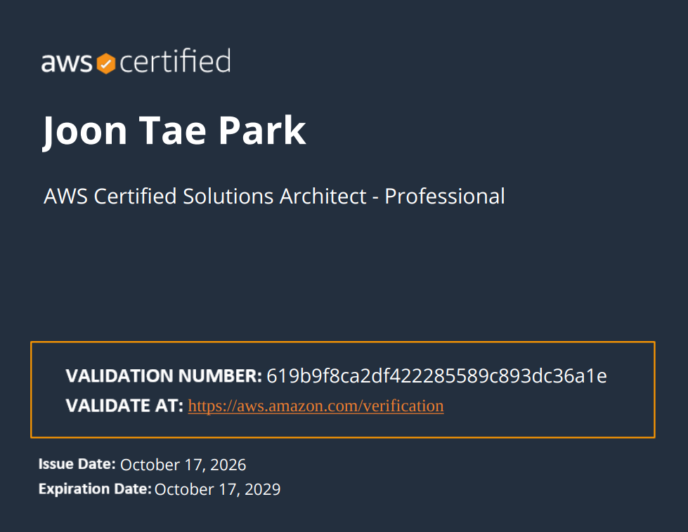

SAA 만료일이 다가오고 있었는데, SAP를 따면 SAA도 자동으로 3년 갱신된다는 걸 알고 상위 자격증인 SAP-C02로 갱신 겸 취득하기로 했다. AWS 실무는 1년 정도 했지만 얕게 썼고(MSP, 2024~2025), 지금은 회사에서 NHN Cloud를 쓰고 있어서 AWS 쪽 감이 많이 떨어져 있었다.

목표 시험일을 10/17로 잡고 9/25부터 공부를 시작했으니 약 3주, 직장인이라 공부는 전부 퇴근 후 저녁 시간에만 했다.

### 공부 자료

Tutorials Dojo(TD) 연습문제(총 391문항, 세트당 75문항씩 5세트, 16문항인 6세트)를 구매해서 풀었다. 대부분 TD로 공부했지만, AWS 공식 Skill Builder 무료 샘플(20문항)로 중간중간 비교해봤다. TD는 문제형식이 겹치면서 서비스가 살짝 바껴서 나오는 문제가 꽤 있는데, 이렇다보니 단순히 외우는게 아니고 개념적인 부분부터 잡고 가는 게 좋았다. 추천하는 편

- 공부 시작 직후 Skill Builder 20문항: 13/20 (65%)
- 시험 당일 아침 재응시: 19/20 (95%)

### 공부 흐름

1. **1회차(리뷰 모드) 1회독** — 6세트를 약 9일에 걸쳐 풀었다. 점수는 52~57%. 이때는 문제를 틀려도 해설을 보고, 맞춰도 해설을 봤다. AWS 네이티브 개념이 부족하기 때문에 모든 해설을 정독했다.
2. **오답 노트 정리 + 복습 1회독** — 세트별로 틀린 문제를 전부 모아 정답/해설과 함께 다시 정리하고, 전체를 한 번 다시 읽었다.
3. **타임드 모드 실전 모의고사 5세트** — 오답 복습이 끝난 뒤, 타이머 걸고 처음 보는 느낌으로 75문항씩 5번 풀었다.
   - 65/75(86.7%) → 68/75(90.7%) → 64/75(85.3%) → 62/75(82.7%) → 54/75(72.0%)
4. **재풀이** — 오답을 그냥 다시 읽는 것보다, 오답노트에 체크박스를 달아서 "재풀이에서 또 틀린 문제"만 따로 추렸다.
5. **약점 영역 압축 개념노트** — 반복되는 주제별로 토글 없이 표 2개(상황 키워드→선택, 바로 오답인 보기) 정도로만 짧게 정리했다. 다 적지 않고 판단 기준만 압축하는 게 실제로 도움이 됐다.

### 자주 헷갈렸던 유형

- **ID 페더레이션**: SAML IdP vs OIDC vs Cognito User Pool/Identity Pool vs IAM Identity Center를 상황(직원/앱 사용자, 기존 IdP 유무)으로 구분하는 문제가 반복됨.
- **서버리스 비동기 처리 패턴**: Lambda 15분 타임아웃/버스트 동시성 한계에 걸리는 상황에서 Step Functions·AWS Batch·컨테이너화(ECS Fargate)·EC2 중 뭘 골라야 하는지 판단하는 유형.
- **마이그레이션/DR**: RPO/RTO 숫자(분 단위)로 Aurora Global Database vs Multi-AZ vs 교차 리전 읽기 복제본을 갈라야 하는 문제.
- **VPC 엔드포인트 계열**: 게이트웨이 엔드포인트(S3/DynamoDB 전용) vs 인터페이스 엔드포인트(PrivateLink) vs Route 53 Resolver 인바운드/아웃바운드 엔드포인트 — 이름이 비슷해서 제일 헷갈렸던 부분.
- **IoT 엣지**: AWS IoT Greengrass vs AWS Outposts vs SageMaker Edge Manager — "로컬에서 추론, 오프라인 동작"이라는 키워드가 나오면 보통 Greengrass.

### 느낀 점

문제 양보다 복습 방식이 더 중요했다. 오답을 다시 읽기만 하면 "본 적 있다"는 착각이 생기는데, 재풀이에서 또 틀리는지를 체크해야 진짜 약점이 보였다. 시험 전날 점수가 떨어져서 불안했지만, 여러 번의 타임드 점수를 평균으로 보고 하루치 변동에 휘둘리지 않은 게 도움이 됐다.

### 결과

합격. SAA도 자동으로 갱신.
