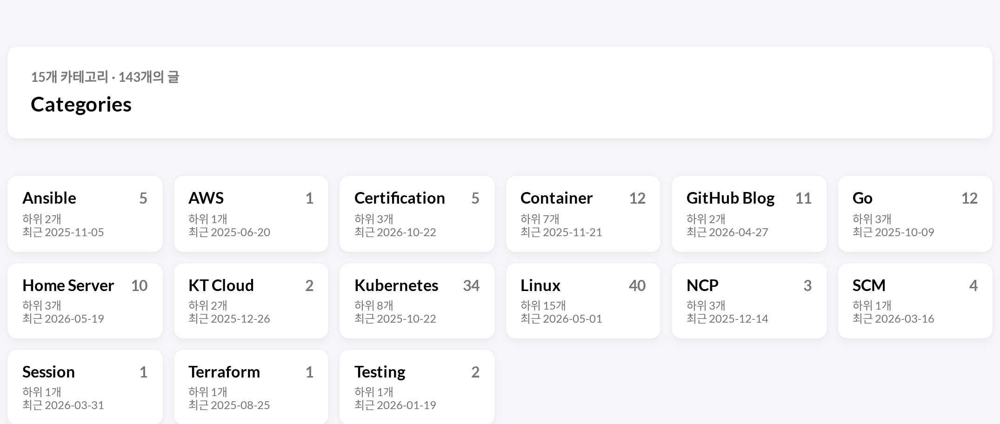
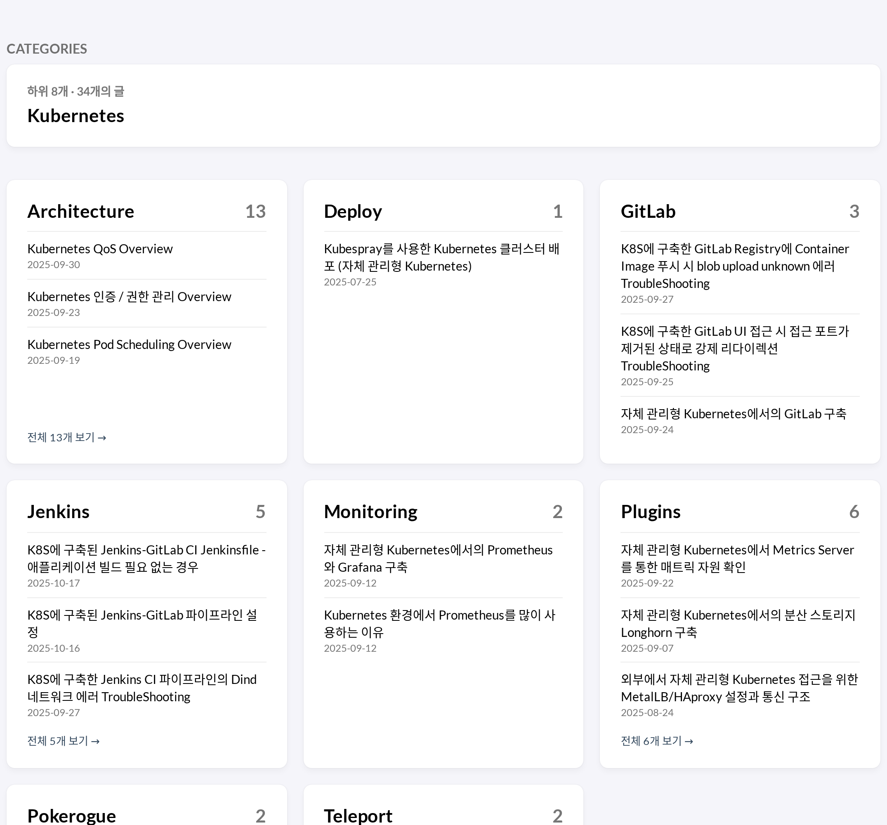
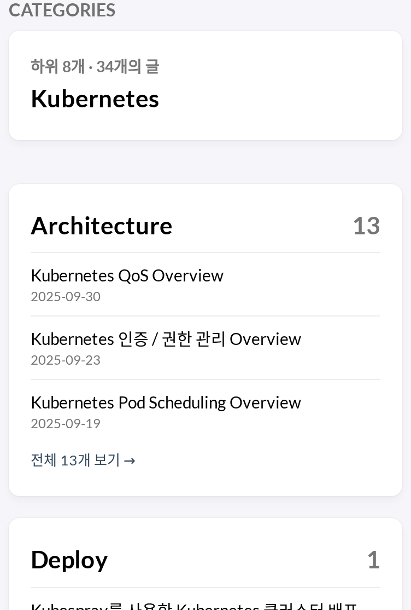
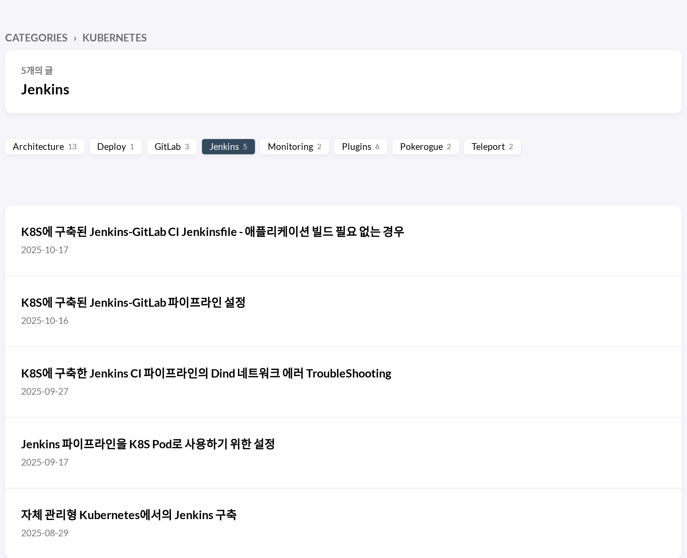

> Hugo Stack 테마에 1차/2차 두 단계로 된 카테고리를 직접 구현한 구조와 화면 설계

## 1. 직접 만든 이유

- Hugo의 기본 카테고리(taxonomy)는 평면 구조임

    - 포스트에 `categories: ["Kubernetes", "Jenkins"]`라고 적어도 Hugo는 `Kubernetes`와 `Jenkins`를 서로 관계없는 두 개의 카테고리로 취급함

    - 그래서 `Container` 아래의 Jenkins 글과 `Kubernetes` 아래의 Jenkins 글이 `/categories/jenkins/` 한 페이지에 섞임

- 원하는 것은 폴더처럼 내려가는 2단계 구조

    - `/categories/` → `/categories/kubernetes/` → `/categories/kubernetes/jenkins/`

    - 1차 카테고리는 환경이나 분야(Linux, Kubernetes, Container…), 2차 카테고리는 그 안의 도구나 주제(Jenkins, GitLab, Monitoring…)

- 규칙은 하나만 둠

    - 모든 포스트의 `categories`는 **정확히 2개**: `["1차", "2차"]`

    - 오타가 나면 그대로 새 카테고리가 생기므로 front matter를 쓸 때 기존 이름과 맞춰야 함

---

## 2. 전체 구조

| 파일 | 역할 |
| --- | --- |
| `scripts/generate-categories.go` | 빌드 전에 포스트를 읽어 카테고리 페이지 파일을 생성 |
| `layouts/partials/category-index.html` | 포스트를 한 번 순회해서 1차 → 2차 → 포스트 구조를 만듦 |
| `layouts/categories/list.html` | `/categories/` 화면 |
| `layouts/_default/category-primary.html` | `/categories/<1차>/` 화면 |
| `layouts/_default/category-secondary.html` | `/categories/<1차>/<2차>/` 화면 |
| `assets/scss/custom.scss` | 세 화면의 스타일 |

- 배포는 GitHub Actions에서 두 단계로 실행됨

    ```yaml
    - name: Generate category pages
      run: go run scripts/generate-categories.go

    - name: Build
      run: hugo --minify --gc
    ```

- 생성되는 `content/categories/`는 `.gitignore`에 넣고 커밋하지 않음

    - 빌드할 때마다 지우고 다시 만들기 때문에 포스트의 카테고리만 고치면 페이지는 따라옴

---

## 3. 카테고리 페이지 생성 스크립트

- Hugo는 front matter 값만 보고 페이지를 새로 만들어 주지 않음

    - `/categories/kubernetes/jenkins/` 같은 페이지가 존재하려면 그 주소에 해당하는 content 파일이 있어야 함

    - 그래서 빌드 전에 Go 스크립트가 파일을 만들어 둠

- 스크립트가 하는 일

    1. `content/post/*/index.md`를 모두 읽음

    1. 정규식으로 `categories: ["1차", "2차"]`를 뽑아 1차 → 2차 집합을 만듦

    1. `content/categories/`를 지우고 1차마다 `_index.md`, 2차마다 `<2차>.md`를 생성

- 생성되는 파일 예시

    - 1차: `content/categories/kubernetes/_index.md`

        ```yaml
        ---
        title: "Kubernetes"
        description: "Kubernetes 카테고리의 모든 포스트"
        primary_category: "Kubernetes"
        layout: "category-primary"
        url: "/categories/kubernetes/"
        ---
        ```

    - 2차: `content/categories/kubernetes/jenkins.md`

        ```yaml
        ---
        title: "Jenkins"
        description: "Kubernetes > Jenkins 카테고리의 포스트"
        primary_category: "Kubernetes"
        secondary_category: "Jenkins"
        layout: "category-secondary"
        url: "/categories/kubernetes/jenkins/"
        ---
        ```

- `layout`으로 어떤 템플릿을 쓸지 정하고, `primary_category` / `secondary_category`로 템플릿에 자기가 어떤 카테고리인지 알려줌

- `url`을 직접 박아 두어서 주소가 파일 경로 해석 방식에 흔들리지 않게 함

---

## 4. 카테고리 인덱스 partial

- 세 화면 모두 "어떤 1차 아래 어떤 2차가 있고, 각각 글이 몇 개인지"가 필요함

    - 화면마다 포스트 전체를 몇 번씩 돌면서 세면 같은 코드가 세 군데에 흩어지고, 포스트가 늘수록 빌드가 느려짐

    - 그래서 한 번만 돌아서 구조를 만들고 세 화면이 같이 쓰도록 partial로 분리함

- 반환하는 구조

    ```text
    [ { name, key, count, latest, link,
        subs: [ { name, key, count, link, pages } ] } ]
    ```

    - `pages`는 그 2차 카테고리의 포스트 목록(최신순)

    - `key`는 정렬용 소문자 이름

- 코드

    ```go-html-template
    {{- $s := newScratch -}}
    {{- range $p := site.Pages -}}
        {{- with $p.Params.primary_category -}}
            {{- $key := . -}}
            {{- with $p.Params.secondary_category -}}
                {{- $key = printf "%s|%s" $key . -}}
            {{- end -}}
            {{- $s.SetInMap "link" $key $p.RelPermalink -}}
        {{- end -}}
    {{- end -}}
    {{- range $p := (where site.RegularPages "Section" "post").ByDate.Reverse -}}
        {{- $c := $p.Params.categories -}}
        {{- if ge (len $c) 2 -}}
            {{- $m := index $c 0 -}}
            {{- $sub := printf "%s|%s" $m (index $c 1) -}}
            {{- $s.SetInMap "mains" $m $m -}}
            {{- $s.SetInMap (printf "subs|%s" $m) $sub (index $c 1) -}}
            {{- $s.Add (printf "n|%s" $m) 1 -}}
            {{- $s.Add (printf "pages|%s" $sub) (slice $p) -}}
            {{- if not ($s.Get (printf "latest|%s" $m)) -}}
                {{- $s.Set (printf "latest|%s" $m) $p.Date -}}
            {{- end -}}
        {{- end -}}
    {{- end -}}
    {{- $links := $s.Get "link" -}}
    {{- $result := slice -}}
    {{- range $m := $s.Get "mains" -}}
        {{- $subs := slice -}}
        {{- range $sub, $name := $s.Get (printf "subs|%s" $m) -}}
            {{- $pages := $s.Get (printf "pages|%s" $sub) -}}
            {{- $subs = $subs | append (dict "name" $name "key" (lower $name) "count" (len $pages) "link" (index $links $sub) "pages" $pages) -}}
        {{- end -}}
        {{- $result = $result | append (dict
            "name" $m
            "key" (lower $m)
            "count" ($s.Get (printf "n|%s" $m))
            "latest" ($s.Get (printf "latest|%s" $m))
            "link" (index $links $m)
            "subs" (sort $subs "key")) -}}
    {{- end -}}
    {{- return sort $result "key" -}}
    ```

- 포인트 두 가지

    1. **링크는 생성된 페이지에서 가져옴**

        - 템플릿에서 `printf "/categories/%s/" ($name | urlize)`로 주소를 만들면, Go 스크립트가 만든 주소와 Hugo의 `urlize`가 만든 주소가 특수문자나 공백 처리에서 어긋날 수 있음

        - 어긋나면 링크만 404가 나고 빌드는 성공해서 알아채기 어려움

        - 처음 순회에서 생성된 카테고리 페이지들의 `RelPermalink`를 맵에 담아 두고 그 값을 쓰면 두 쪽이 다를 일이 없음

    1. **`partialCached`로 부름**

        - 세 화면에서 `partialCached "category-index.html" . "category-index"`처럼 같은 키로 부르면 빌드 전체에서 한 번만 계산됨

---

## 5. 화면 설계: 페이지마다 한 단계만 주인공으로

- 처음에는 `/categories/`에 1차 카테고리 카드를 두고 그 안에 2차를 작은 칩으로 넣었음

    - 이렇게 하니 2차가 1차의 꼬리표처럼 보였음

    - 실제로 글을 찾을 때 구분하는 기준은 2차(도구)인데 정작 2차가 눈에 띄지 않았음

- 그래서 단계마다 그 단계의 카테고리만 크게 보여주도록 나눔

### 5.1 `/categories/`: 1차 카테고리 타일

- 이름, 글 수, 하위 카테고리 수, 최근 글 날짜만 담은 작은 타일

- 15개 정도라 한 화면에 다 들어옴



### 5.2 `/categories/<1차>/`: 2차 카테고리 카드

- 2차마다 카드 하나, 카드 안에 최근 글 3개와 날짜

- 글이 4개 이상이면 `전체 N개 보기 →` 링크

- 글이 1개뿐인 2차도 카드에 그 글 제목이 바로 보여서, 이름만 있을 때보다 무엇이 들어 있는지 알기 쉬움



- 폰에서는 카드가 한 줄에 하나씩 쌓임

    - `grid-template-columns: repeat(auto-fill, minmax(260px, 1fr))`이라 화면 폭에 맞춰 열 수가 알아서 바뀜



### 5.3 `/categories/<1차>/<2차>/`: 글 목록

- 위쪽에 `Categories › Kubernetes` 위치 표시

- 같은 1차 아래의 다른 2차를 칩으로 보여주고 지금 보는 칩을 강조함

- 글 목록은 직접 만들지 않고 테마의 `article-list/compact` partial을 그대로 씀

    - 메인 페이지 글 목록과 모양이 같아지고, 테마가 업데이트되면 같이 바뀜



### 5.4 정렬

- 카테고리를 고르는 단계(1차 타일, 2차 카드)는 **이름순**

    - 찾는 카테고리의 위치를 예측할 수 있음

    - `lower`로 만든 `key`로 정렬해서 `k6` 같은 소문자 이름이 맨 뒤로 밀리지 않게 함

- 글이 보이는 단계(카드 안 최근 글, 2차 페이지 목록)는 **최신순**

### 5.5 템플릿 예시

- 1차 페이지 템플릿

    - partial 결과에서 자기 1차를 찾아 2차 카드를 그리기만 함

    ```go-html-template
    {{ define "main" }}
        {{ $cats := partialCached "category-index.html" . "category-index" }}
        {{ $me := index (where $cats "name" .Params.primary_category) 0 }}

        <header>
            <h3 class="section-title category-breadcrumb">
                <a href="{{ "categories/" | relURL }}">Categories</a>
            </h3>
            <div class="section-card">
                <div class="section-details">
                    <h3 class="section-count">하위 {{ len $me.subs }}개 · {{ $me.count }}개의 글</h3>
                    <h1 class="section-term">{{ $me.name }}</h1>
                </div>
            </div>
        </header>

        <section class="category-grid">
            {{ range $me.subs }}
                <article class="category-card">
                    <a class="category-card__head" href="{{ .link }}">
                        <h2 class="category-card__title">{{ .name }}</h2>
                        <span class="category-card__count">{{ .count }}</span>
                    </a>
                    <ul class="category-card__posts">
                        {{ range first 3 .pages }}
                            <li>
                                <a href="{{ .RelPermalink }}">{{ .Title }}</a>
                                <time datetime="{{ .Date.Format "2006-01-02" }}">{{ .Date.Format "2006-01-02" }}</time>
                            </li>
                        {{ end }}
                    </ul>
                    {{ if gt .count 3 }}
                        <a class="category-card__more" href="{{ .link }}">전체 {{ .count }}개 보기 →</a>
                    {{ end }}
                </article>
            {{ end }}
        </section>
    {{ end }}
    ```

    - 머리 부분은 테마의 `section-card` 클래스를 그대로 써서 다른 목록 페이지와 모양을 맞춤

---

## 6. 스타일

- 스타일은 `assets/scss/custom.scss` 한 곳에 둠

    - Stack 테마는 이 파일을 자동으로 가져옴

    - 레이아웃 파일 안에 `<style>`을 넣으면 페이지마다 스타일이 흩어지고 테마 SCSS 변수를 못 씀

- 색과 그림자는 테마 CSS 변수만 씀

    - `--card-background`, `--accent-color`, `--accent-color-text`, `--shadow-l1`, `--card-separator-color` 등

    - 다크 모드로 바꾸면 변수 값이 바뀌므로 따로 다크 모드 스타일을 만들 필요가 없음

- 칩 강조가 안 보였던 문제

    - 2차 페이지 위쪽 칩 줄에 흰 배경을 주는 규칙(`.category-chips--nav .category-chip`)이 강조 규칙(`.category-chip.is-active`)보다 선택자가 구체적이라 이김

    - 강조 시 글자는 흰색, 배경은 흰색이 되어 지금 보는 칩이 빈칸처럼 보였음

    - 강조 규칙을 칩 줄 규칙 뒤에 두고 같은 구체성으로 한 번 더 적어서 해결

    ```scss
    .category-chip {
        .category-chips--nav & {
            background-color: var(--card-background);
            box-shadow: var(--shadow-l1);
        }

        &:hover,
        &.is-active,
        .category-chips--nav &:hover,
        .category-chips--nav &.is-active {
            background-color: var(--accent-color);
            color: var(--accent-color-text);
        }
    }
    ```

---

## 7. 주의할 점

- **커스텀 레이아웃에는 `{{ define "main" }}`만 정의함**

    - `footer`나 `sidebar` 블록을 정의하거나 `partial "footer/footer"`를 직접 부르면 테마의 `baseof.html`과 겹쳐서 댓글 같은 외부 스크립트가 깨짐

- **사이트 안 링크는 `relURL`이나 `.RelPermalink`로 만듦**

    - `/categories/`처럼 주소를 문자열로 박으면 사이트를 하위 경로에 올렸을 때 링크가 틀어짐

- **테마 파일은 고치지 않고 같은 경로로 `layouts/`에 덮어씀**

    - 테마 모듈을 업데이트해도 커스텀이 유지되고, 바꾼 범위가 `layouts/`에만 남음

- **`categories`는 정확히 2개**

    - 1개만 적은 포스트는 카테고리 화면에 나오지 않음

    - 이름 오타는 새 카테고리를 만듦
